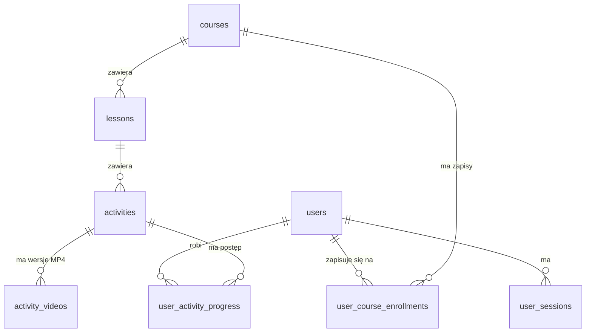

# Schemat bazy danych

Aktualne definicje SQL znajdują się w [schema.sql](schema.sql). Poniżej jest skrócony diagram i opis tabel aplikacyjnych.

| Tabela | Klucz / relacje | Najważniejsze dane |
| --- | --- | --- |
| `users` | `id`, unikalne `google_sub` | profil Google, `preferred_language`, saldo `shark_coins` |
| `user_sessions` | `token_hash`, `user_id → users` | skrót tokenu sesji i jej data wygaśnięcia |
| `courses` | `id`, unikalne `slug` | dane kursu i JSON `translations` dla `pl/en/de` |
| `lessons` | `id`, `course_id → courses` | kolejność, XP, publikacja i tłumaczenia |
| `activities` | `id`, `lesson_id → lessons` | `article`, `quiz` albo `video`; JSON `content` i `translations` |
| `activity_videos` | `id`, `activity_id → activities`, unikalne `(activity_id, language)` | binarne MP4 (`BYTEA`) i metadane konkretnej wersji językowej |
| `user_course_enrollments` | `user_id → users`, `course_id → courses`, unikalna para | zapis użytkownika i status ukończenia kursu |
| `user_activity_progress` | `user_id → users`, `activity_id → activities`, unikalna para | wynik quizu, odpowiedzi, XP, SharkCoiny i ukończenie |

## Zasady danych

- Usunięcie kursu usuwa jego lekcje, aktywności, filmy i zależny postęp przez `ON DELETE CASCADE`.
- Polski tekst jest w głównych kolumnach; angielski i niemiecki są w `translations` typu `JSONB`.
- Quiz przechowuje pytania w `activities.content`; poprawne odpowiedzi pozostają po stronie backendu i nie są zwracane przez szczegół aktywności.
- Film ma osobny rekord dla każdego dostępnego języka. Dane MP4 są `deferred` w ORM, więc lista kursów nie odczytuje binariów.
- Symulacja inwestowania nie ma tabeli: jej stan jest obecnie pamięcią procesu backendu.
